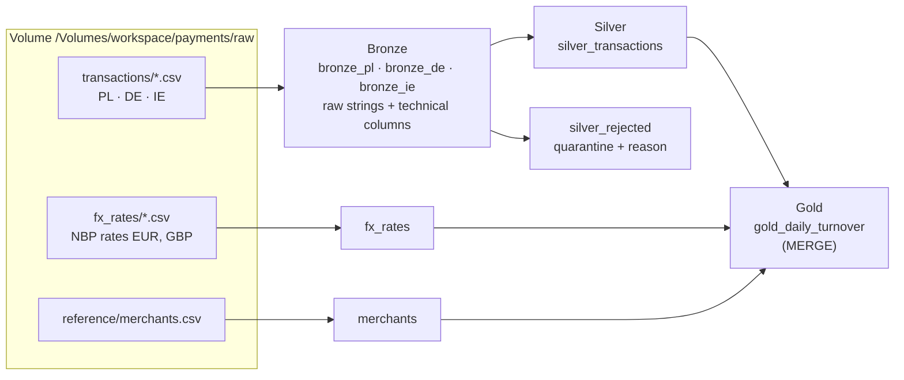
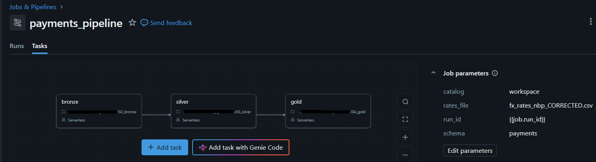
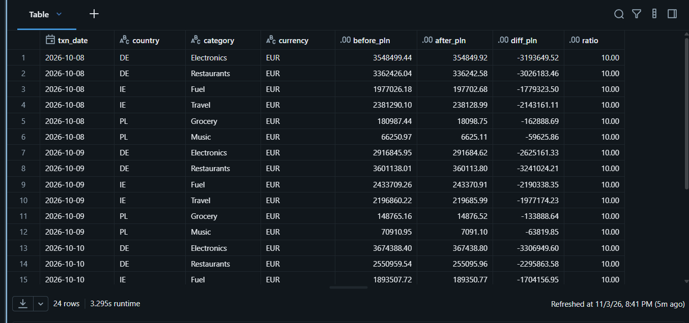

# Payments Lakehouse on Databricks

End-to-end batch pipeline for card payment transactions from three countries (**PL, DE, IE**), built on **Databricks Free Edition** with **Unity Catalog**, **Delta Lake**, **PySpark** and **Lakeflow Jobs**.

Raw CSV files land in a volume, flow through the **Bronze → Silver → Gold** (medallion) layers and end up as a daily turnover table in PLN for management reporting.
The dataset is synthetic and contains deliberately planted data quality issues (different formats per country, duplicates, corrections sent twice, invalid values, wrong FX rates).

---

## Goal and requirements

**Business goal.** Management needs one daily view of card turnover in **PLN** per day, country, merchant category and currency. The data comes from three national processors, each delivering daily CSV files in its own format.

**Requirements**
- Ingest the daily files from PL, DE and IE exactly as delivered, although formats differ per country.
- Build one common, typed transaction model in which every `txn_id` appears at most once.
- Never lose a record: invalid rows are quarantined with a reason, and the row counts must reconcile.
- A re-sent file (`_v2`) replaces the earlier version of the same transactions.
- Convert amounts to PLN with NBP rates. Without a rate (weekend, holiday) use the last published rate, at most 3 days back; PLN = 1.
- Gold counts only `SETTLED` transactions and is loaded with MERGE, so a re-run produces the same result.
- Run as one Job; any failed check stops the downstream steps.
- Allow corrections of historical data (backfill) without rebuilding everything, with a before/after comparison.

**Assumptions and scope**
- Daily batch files named `transactions_<COUNTRY>_<YYYYMMDD>[_v<N>].csv`.
- FX rates: NBP rates for EUR and GBP, published on business days only.
- One category per merchant in the reference file.
- Synthetic data: 5 days (8–12.10.2026), ~4,200 transactions, with planted data quality issues.
- Out of scope: streaming, time-zone conversion, BI dashboards, access control.

---

## Architecture



Orchestration: one Lakeflow Job `payments_pipeline` with three dependent notebook tasks `bronze → silver → gold` on serverless compute. A failed check in any task stops the downstream tasks.



---

## Layers

| Layer | Tables | What happens | Rows |
|---|---|---|---|
| **Bronze** | `bronze_pl`, `bronze_de`, `bronze_ie` | CSV loaded 1:1, all columns as STRING, + `_source_file`, `_file_mod_ts`, `_load_ts`, `_run_id`, `_rescued_data` | 1515 / 1265 / 1421 = **4201** |
| **Silver** | `silver_transactions` | common schema, typed (`timestamp`, `decimal(12,2)`), cleaned, deduplicated | **3636** |
| | `silver_rejected` | everything that failed validation or lost deduplication, with `reject_reason` and original raw values | **565** |
| **Reference** | `fx_rates`, `merchants` | typed lookup tables with uniqueness checks | 16 / 60 |
| **Gold** | `gold_daily_turnover` | day × country × merchant category × currency → `txn_count`, `turnover_pln` (SETTLED only) | **50** rows, 3103 transactions |

Every run reconciles the numbers: **Silver + Rejected = Bronze**, `txn_id` is unique in Silver, and Gold totals equal the SETTLED transactions (count and PLN sum) before and after the MERGE.

---

## Data quality issues found and how they are handled

| Issue | Example | Handling |
|---|---|---|
| Different formats per source | PL: `;`, `DD.MM.YYYY HH:MM`, decimal comma, Polish headers; DE: German headers; IE: ISO timestamp with `T` | per-country config: separator, column mapping, timestamp format, decimal separator |
| Impossible date | `31.02.2026` | `try_to_timestamp` → NULL → rejected `invalid_date` |
| Negative amounts | `-123.45` | rejected `negative_amount` — refunds in the data have positive amounts with status `REFUNDED`, so a minus sign is an error |
| Dirty currency codes | `eur `, empty, `USD` | `trim` + `upper`; empty → `missing_currency`; currency without FX rate → `wrong_currency` |
| Missing merchant | empty `merchant_id` | rejected `missing_merchant_id` |
| Duplicates in a file | same row twice | kept once, the copy → `duplicate` |
| Corrected files | IE `_v1` and `_v2` for the same day | newest version wins (file date, then file version) |
| Currency ≠ country | EUR payments in Poland | **kept** — real payments with foreign cards, converted with the FX rate |
| No FX rate on weekends | 10–11.10 | last published rate, at most 3 days back; PLN = 1 |
| Wrong FX rates | EUR on 8–9.10 ×10 too high | logged as suspicious (day-over-day change > 5 %), fixed by a backfill |

Rejected rows by reason: `duplicate` 451, `negative_amount` 60, `missing_merchant_id` 30, `wrong_currency` 13, `invalid_date` 8, `missing_currency` 3.

---

## Key decisions

- **Bronze keeps raw strings.** Nothing is parsed on load, so no value can break ingestion or get lost; parsing rules can change later and Bronze is simply re-processed.
- **Quarantine instead of dropping.** Bad rows go to `silver_rejected` with a reason and the original raw values, so they can be investigated and the totals still reconcile.
- **Deduplicate before validating.** The newest version of a transaction wins even if it is invalid. Validating first would let an older, outdated version slip into Silver when the correction is broken.
- **Data contracts.** Each source has an expected header; a renamed or extra column stops the run (schema drift) instead of failing later with a confusing error.
- **FX calendar.** A calendar of every day × currency plus `last(..., ignorenulls=True)` over `rowsBetween(-3, 0)`. Because the calendar has no gaps, 3 rows back = 3 days back; a longer gap fails loudly instead of using a stale rate.
- **Money as `decimal`, banker's rounding.** No floating point; `bround` so rounding errors cancel out instead of accumulating.
- **Gold loaded with MERGE.** Only rows whose numbers changed are rewritten (`WHEN MATCHED AND ... IS DISTINCT FROM ...`); keys that disappear from the source are deleted. Running the pipeline twice changes nothing.
- **Lineage.** `_run_id` (the Job run id) is written to every layer, so each row can be traced back to the run that produced it.

---

## Backfill case study: wrong EUR rates

The FX file had EUR rates for 8–9.10 that were 10× too high (decimal point shifted). The pipeline flagged them as suspicious; a corrected file arrived later.

1. Uploaded `fx_rates_nbp_CORRECTED.csv` to the volume.
2. Ran **only the `gold` task** with the job parameter `rates_file = fx_rates_nbp_CORRECTED.csv`.
3. MERGE updated **24 rows, inserted 0, deleted 0**. The other 26 rows were not touched.
4. Compared Gold before and after with **Delta time travel** (`VERSION AS OF`):

| | Before | After |
|---|---|---|
| Gold turnover (PLN) | 46,917,751.21 | **6,966,627.29** |
| SETTLED transactions | 3103 | 3103 |
| Changed rows | – | 24 (EUR, 8–11.10, ratio 10.00) |



Not only 8–9.10 changed: the **weekend 10–11.10** inherited Friday's wrong rate through the FX calendar, so it was corrected as well.
Afterwards the job default for `rates_file` was switched to the corrected file, so a regular run does not bring the wrong rates back.

---

## How to run

1. Create a Unity Catalog schema `payments` and a volume `raw` (catalog `workspace` on Free Edition).
2. Upload `data/transactions/`, `data/reference/` and `data/fx_rates/` to the volume.
3. Import the notebooks from `notebooks/` (Databricks source format, `# COMMAND ----------` = cell).
4. Create a Job with three notebook tasks `02_bronze → 03_silver → 04_gold` and job parameters:

| Parameter | Value |
|---|---|
| `catalog` | `workspace` |
| `schema` | `payments` |
| `run_id` | `{{job.run_id}}` |
| `rates_file` | `fx_rates_nbp_CORRECTED.csv` |

Each notebook can also be run on its own; widgets fall back to the defaults above (`run_id = manual`).

---

## Project structure

```
databricks-payments-lakehouse/
├── README.md
├── docs/                 screenshots
├── notebooks/
│   ├── 02_bronze.py
│   ├── 03_silver.py
│   └── 04_gold.py
└── data/
    ├── transactions/     17 CSV files (5 PL, 5 DE, 7 IE incl. two v2 corrections)
    ├── fx_rates/         fx_rates_nbp.csv, fx_rates_nbp_CORRECTED.csv
    └── reference/        merchants.csv
```

---

## Known limitations and next steps

- **Full reload in Bronze.** Fine for this volume; at scale I would switch to incremental ingestion with **Auto Loader**.
- **Time zones.** Source timestamps are local time without a zone and are stored as-is; a production version should convert them to UTC per country before deriving `txn_date`.
- **One reason per rejected row.** The first failed rule wins (in order of importance); all reasons could be collected into an array.
- **Shared code.** Logging, `check()` and `write_table()` are repeated in each notebook; the next step is a shared module.
- **Tests and deployment.** Unit tests for the transformation functions (pytest on small DataFrames), code in Git and deployment with **Databricks Asset Bundles** + CI.

---

*Author: Gabriel Sawicki*
